# Tech Stack

## Languages

  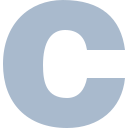&ensp;
  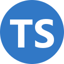&ensp;
  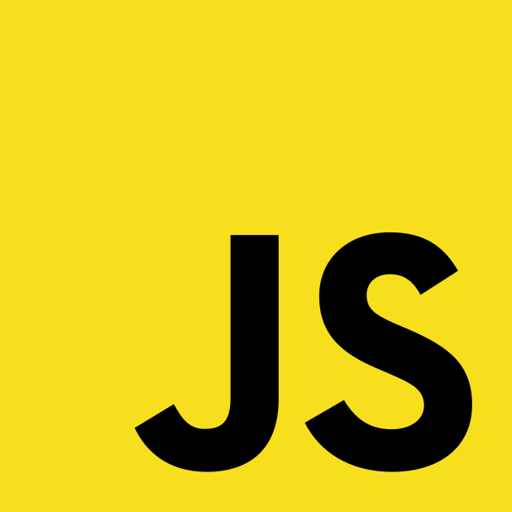&ensp;
  &ensp;&ensp;
  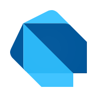&ensp;&ensp;
  &ensp;
  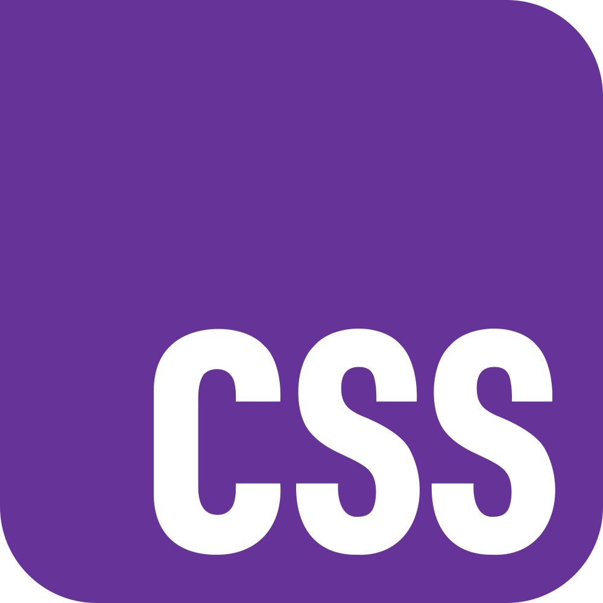

Dart™ and the related logo are trademarks of Google LLC. We are not endorsed by or affiliated with Google LLC.

## Applications

  &ensp;&ensp;
  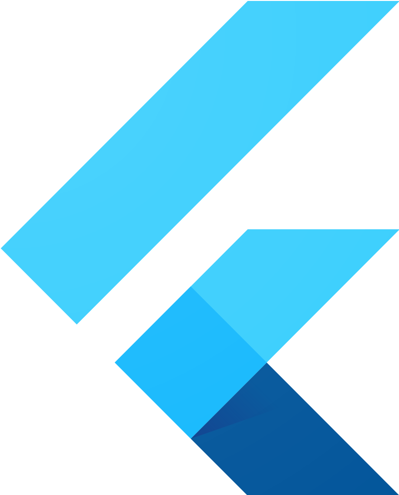&ensp;&ensp;
  <a href="https://nodejs.org/">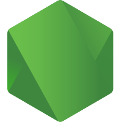</a>

Flutter™ and the related logo are trademarks of Google LLC. We are not endorsed by or affiliated with Google LLC.

## Cloud & Infrastructure

  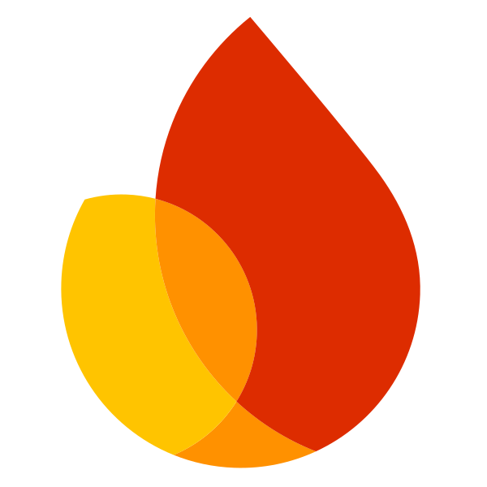&ensp;&ensp;
  &ensp;
  &ensp;
  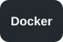

## Tools

  &ensp;
  <a href="https://github.com/robatodt74-byte"><picture><source media="(prefers-color-scheme: dark)" srcset="assets/github-dark.svg" /></picture></a>&ensp;
  <a href="https://www.figma.com/">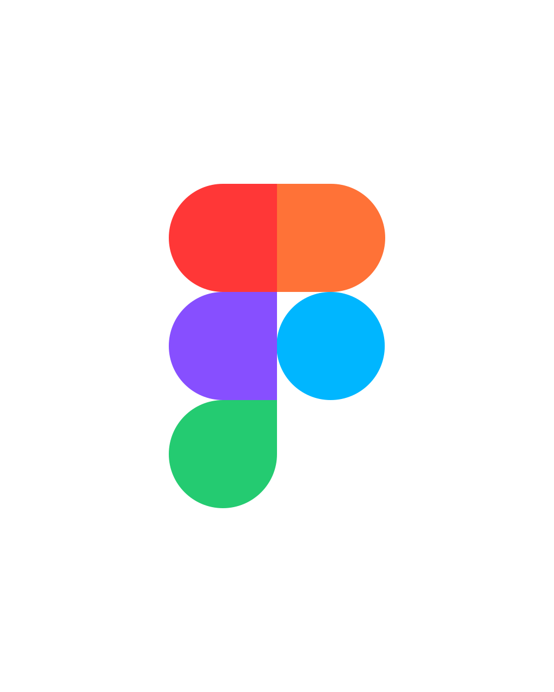</a>&ensp;
  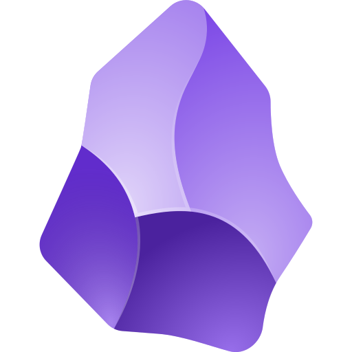&ensp;
  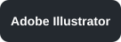&ensp;
  &ensp;
  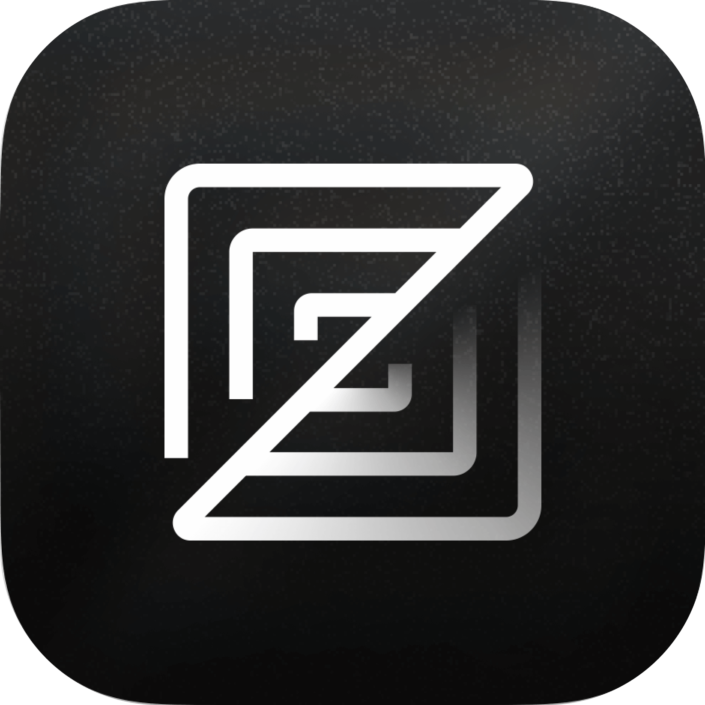

## CAD & Electronics

  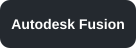&ensp;
  

[Logo credits and sources](assets/SOURCES.md)
